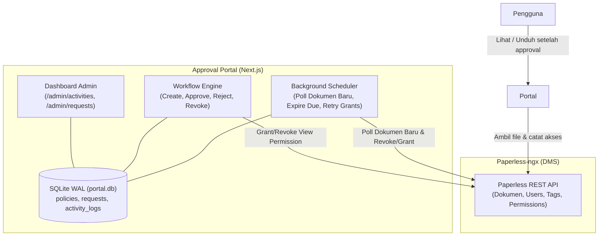
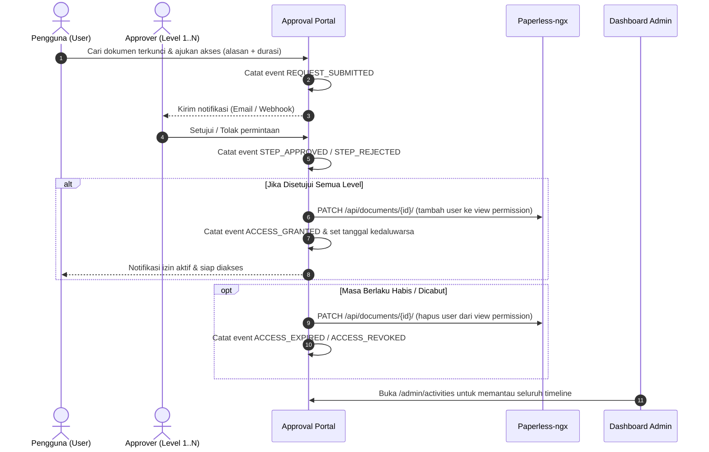

# Portal Approval Dokumen & Monitoring DMS untuk Paperless-ngx

Portal web berbasis Next.js untuk **manajemen persetujuan berjenjang (*tiered approval workflow*) dan pemantauan riwayat aktivitas dokumen** pada Paperless-ngx.

Pengguna masuk menggunakan akun Paperless yang sudah ada. Dokumen sensitif yang terkunci di Paperless dapat diajukan izin aksesnya melalui portal. Setelah semua tingkat approver menyetujui, portal secara otomatis memberikan izin lihat (*view permission*) ke dokumen tersebut melalui REST API Paperless, dan mencabutnya secara otomatis saat masa berlaku habis.

---

## Daftar Isi
- [Fitur Utama](#fitur-utama)
- [Arsitektur & Cara Kerja](#arsitektur--cara-kerja)
- [Aturan Bisnis & Keamanan](#aturan-bisnis--keamanan)
- [Struktur Database](#struktur-database)
- [Panduan Pemasangan & Deployment](#panduan-pemasangan--deployment)
- [Variabel Lingkungan (.env)](#variabel-lingkungan-env)
- [Langkah Konfigurasi Awal](#langkah-konfigurasi-awal)
- [Riwayat Aktivitas & Monitoring Admin](#riwayat-aktivitas--monitoring-admin)
- [Sistem Notifikasi](#sistem-notifikasi)
- [Panduan Pengembangan](#panduan-pengembangan)

---

## Fitur Utama

1. **Alur Persetujuan Berjenjang (*Multi-Level Approval*):**
   - Mendukung 1 hingga 6 tingkat persetujuan per kebijakan.
   - Kebijakan fleksibel berdasarkan tag dokumen di Paperless atau kebijakan *default*.
   - Pembatasan durasi akses (misal maksimal 7 hari, 14 hari, atau permanen).

2. **Sinkronisasi Dokumen DMS Otomatis (*Zero-Configuration* di Paperless):**
   - Background scheduler secara otomatis mendeteksi penambahan dokumen baru di Paperless-ngx tiap 60 detik menggunakan teknik polling aman tanpa perlu mengubah konfigurasi Paperless.
   - Tersedia tombol sinkronisasi manual instan di Dashboard Admin.
   - Mendukung endpoint webhook Paperless opsional (`/api/webhooks/paperless`).

3. **Riwayat Aktivitas Terpadu (*Unified Activity Logs*):**
   - Menangkap seluruh siklus hidup dokumen dan akses:
     - 📄 **Penambahan Dokumen:** Waktu upload, judul, ID, pemilik (*owner*), tipe dokumen, dan status kunci.
     - 🙋‍♂️ **Permintaan Akses:** User pemohon, alasan, dan durasi yang diminta.
     - ⚖️ **Keputusan Approver:** Tingkat level, approver yang memutuskan, komentar, dan waktu persetujuan/penolakan.
     - 🔑 **Pemberian & Pencabutan Hak:** Tanggal aktif, tanggal kedaluwarsa, dan status injeksi izin ke Paperless.
     - 👁️ **Akses Fisik Dokumen:** Pengguna, dokumen, waktu, dan aksi lihat/unduh yang berhasil melalui portal setelah akses aktif.
   - Filter cepat berdasarkan kategori, jenis aktivitas, aktor, dokumen, dan pencarian kata kunci.
   - Ekspor riwayat aktivitas dan audit akses ke **Excel (.xlsx)** dan **PDF**, mengikuti filter yang sedang dipakai.
   - Riwayat lihat/unduh dicatat portal di SQLite; akses langsung melalui antarmuka Paperless tidak tercatat.
   - Super admin dapat membuka dokumen tanpa approval melalui menu **Akses dokumen**; aktivitasnya tetap masuk ke riwayat audit.

4. **Otomatisasi Izin Paperless yang Aman:**
   - Menggunakan Paperless REST API (`set_permissions`).
   - Idempoten: Tidak pernah menimpa atau menghapus izin yang sudah ada sebelumnya milik user/grup lain.
   - Scheduler internal mengecek masa berlaku setiap 60 detik dan otomatis mencabut hak saat kedaluwarsa.
   - Mekanisme *retry* otomatis jika koneksi API Paperless sempat terganggu saat pemberian izin.

5. **Notifikasi Fleksibel:**
   - Webhook JSON untuk integrasi ke bot Telegram, WhatsApp, atau n8n.
   - Email notifikasi otomatis via SMTP langsung ke email pengguna Paperless.

---

## Arsitektur & Cara Kerja



### Siklus Alur Permintaan Akses:


---

## Aturan Bisnis & Keamanan

* **Pemisahan Tugas (*Separation of Duties*):** Satu orang tidak diperbolehkan memutuskan dua level persetujuan pada permintaan yang sama.
* **Anti Persetujuan Mandiri (*No Self-Approval*):** Pemohon tidak dapat menjadi approver untuk permohonannya sendiri. Jika nama pemohon ada di daftar approver kebijakan, namanya otomatis diabaikan.
* **Pencegahan Jalan Buntu (*Dead-end Check*):** Sistem memvalidasi sejak awal pengajuan apakah kombinasi approver antar-level memungkinkan disetujui oleh orang yang berbeda. Jika bertumpuk dan mustahil dipenuhi, pengajuan langsung ditolak.
* **Alasan Penolakan Wajib:** Setiap penolakan (*reject*) wajib disertai komentar alasan minimal 3 karakter.
* **Pembatasan Durasi Kebijakan:** Durasi hari yang diminta tidak boleh melebihi batas maksimum pada kebijakan dokumen.
* **Dokumen Terkunci Saja:** Dokumen tanpa *owner* di Paperless dianggap bebas (sudah bisa dilihat semua orang), sehingga portal menolak pengajuan dokumen yang belum dikunci.
* **Keamanan Kredensial:** Password pengguna tidak pernah disimpan di database portal; password hanya diteruskan sementara ke Paperless saat login untuk verifikasi token. Token superuser hanya tersimpan di server.

---

## Struktur Database

Portal menggunakan SQLite berbasis `better-sqlite3` dengan mode WAL (*Write-Ahead Logging*) yang disimpan di `data/portal.db`:

| Tabel | Deskripsi |
| :--- | :--- |
| `policies` | Definisi kebijakan approval (nama, tag dokumen target, prioritas, batas hari). |
| `policy_steps` | Jenjang/tingkat persetujuan (level 1..6, approvers JSON array, label). |
| `requests` | Data permohonan akses (pemohon, dokumen, alasan, durasi, status, tanggal izin & kedaluwarsa). |
| `request_steps` | Status persetujuan per level untuk tiap permohonan (pending, approved, rejected, decided_by, comment). |
| `request_events` | Log detail pergerakan status internal per dokumen permintaan. |
| `activity_logs` | **Tabel Terpadu Riwayat Aktivitas Sistem:** Dokumen baru DMS, pengajuan akses, approval, hak akses aktif/kedaluwarsa, serta akses fisik PDF. |
| `system_kv` | Pengaturan sistem internal (misal pointer sinkronisasi `last_synced_doc_id`). |

---

## Panduan Pemasangan & Deployment

### Prasyarat
1. Paperless-ngx berjalan di Docker (disarankan dalam network Docker yang sama).
2. Portainer (atau Docker Compose di server).
3. Riwayat lihat/unduh melalui portal tidak memerlukan paket audit terpisah. Aktivitas yang dilakukan langsung di antarmuka Paperless berada di luar pencatatan portal.

### 1. Deployment Menggunakan Docker Compose (Portainer)
Tambahkan Stack baru di Portainer atau jalankan via terminal:

```yaml
services:
  portal:
    build: .
    image: approval-portal:latest
    restart: unless-stopped
    ports:
      - "${PORTAL_PORT:-3000}:3000"
    environment:
      PAPERLESS_URL: ${PAPERLESS_URL:-http://webserver:8000}
      PAPERLESS_SERVICE_TOKEN: ${PAPERLESS_SERVICE_TOKEN:?isi token superuser}
      SESSION_SECRET: ${SESSION_SECRET:?isi session secret acak minimal 32 karakter}
      APP_URL: ${APP_URL:-http://localhost:3000}
      AUDIT_URL: ${AUDIT_URL:-http://audit:8080}
      AUDIT_API_KEY: ${AUDIT_API_KEY:-}
      AUDIT_VIEWERS: ${AUDIT_VIEWERS:-}
      PAPERLESS_HOST_HEADER: ${PAPERLESS_HOST_HEADER:-}
      SESSION_HOURS: ${SESSION_HOURS:-8}
      COOKIE_SECURE: ${COOKIE_SECURE:-false}
      DISPLAY_TZ: ${DISPLAY_TZ:-Asia/Jakarta}
      NOTIFY_WEBHOOK_URL: ${NOTIFY_WEBHOOK_URL:-}
      SMTP_HOST: ${SMTP_HOST:-}
      SMTP_PORT: ${SMTP_PORT:-587}
      SMTP_USER: ${SMTP_USER:-}
      SMTP_PASS: ${SMTP_PASS:-}
      SMTP_FROM: ${SMTP_FROM:-approval@localhost}
    volumes:
      - portal_data:/data
    networks:
      - paperless

volumes:
  portal_data:

networks:
  paperless:
    external: true
    name: ${PAPERLESS_NETWORK:?isi nama docker network paperless}
```

Jalankan perintah build dan up:
```bash
docker compose up -d --build
```

### Deployment otomatis dengan GitHub Actions

Workflow `.github/workflows/deploy.yml` menjalankan pemeriksaan tipe, test, dan build pada setiap pull request ke `develop` atau `main`. Setelah perubahan di-push ke `develop`, aplikasi di-deploy ke development; push ke `main` men-deploy production. Deployment dilakukan Docker Compose langsung oleh self-hosted runner di masing-masing server—tidak memakai SSH.

1. Siapkan satu Linux server dengan Docker Engine, Docker Compose v2.17+, dan satu GitHub Actions self-hosted runner. Workflow menggunakan label bawaan `self-hosted` dan `linux`; tidak memerlukan label `development` atau `production`.
2. Pastikan user runner dapat menjalankan `docker compose` dan server terhubung ke network Docker Paperless.
3. Buat GitHub Environments bernama `development` dan `production`. Batasi branch deployment masing-masing ke `develop` dan `main`; aktifkan required reviewer untuk `production` bila perlu persetujuan sebelum deploy.
4. Tambahkan **variables** di kedua Environment: `PAPERLESS_NETWORK`, `PAPERLESS_URL`, `PAPERLESS_PUBLIC_URL`, `APP_URL`, `PORTAL_PORT`, `COOKIE_SECURE`, `DISPLAY_TZ`, `SESSION_HOURS`, `SEARCH_MIN_CHARS`, `MAX_GRANT_ATTEMPTS`, `PAPERLESS_HOST_HEADER`, `AUDIT_URL`, `AUDIT_VIEWERS`, `SMTP_HOST`, `SMTP_PORT`, `SMTP_USER`, dan `SMTP_FROM`. Karena kedua environment berjalan di server yang sama, tetapkan `PORTAL_PORT` yang berbeda untuk development dan production (misalnya `3001` dan `3000`) dan URL `APP_URL` masing-masing.
5. Tambahkan **secrets** pada masing-masing Environment: `PAPERLESS_SERVICE_TOKEN` dan `SESSION_SECRET` (minimal 32 karakter acak). `SMTP_PASS`, `AUDIT_API_KEY`, dan `NOTIFY_WEBHOOK_URL` bersifat opsional.
6. Buat pull request ke `develop` untuk validasi. Setelah merge/push, periksa tab **Actions**. Workflow juga dapat dijalankan manual dari branch `develop` atau `main`.

Compose menggunakan project terpisah (`approval-portal-development` dan `approval-portal-production`), sehingga volume SQLite `portal_data` tidak bercampur walaupun menggunakan runner/server yang sama. Deploy menunggu health check aplikasi sebelum dinyatakan berhasil; jangan menjalankan `docker compose down -v` karena perintah itu menghapus volume data.

Jika kredensial dari konfigurasi lama pernah dipublikasikan, rotasi kredensial tersebut di layanan terkait; menghapusnya dari file terbaru tidak menghapusnya dari riwayat Git.

---

## Variabel Lingkungan (.env)

Contoh template lengkap tersedia di [`.env.example`](file:///d:/approval-portal/.env.example):

| Variabel | Wajib? | Keterangan |
| :--- | :---: | :--- |
| `PAPERLESS_URL` | **Ya** | Alamat internal webserver Paperless (misal `http://webserver:8000` atau `http://192.168.10.x:8010`). |
| `PAPERLESS_SERVICE_TOKEN` | **Ya** | API Auth Token user Paperless berstatus **Superuser**. Digunakan backend portal untuk mengubah izin dokumen. |
| `SESSION_SECRET` | **Ya** | String acak minimal 32 karakter untuk enkripsi tanda tangan cookie sesi (`openssl rand -base64 48`). |
| `APP_URL` | **Ya** | URL publik portal seperti yang diakses user (misal `http://approval.kantor.com:3000`). |
| `PAPERLESS_NETWORK` | **Ya** (Docker) | Nama network Docker tempat container Paperless berjalan. |
| `AUDIT_VIEWERS` | Tidak | Username non-admin yang diizinkan melihat riwayat akses portal (pisahkan koma). |
| `AUDIT_URL` / `AUDIT_API_KEY` | Tidak | Konfigurasi kompatibilitas endpoint proxy audit eksternal; tidak diperlukan untuk riwayat akses dashboard. |
| `PAPERLESS_HOST_HEADER` | Tidak | Header host jika Paperless membatasi `PAPERLESS_ALLOWED_HOSTS`. |
| `COOKIE_SECURE` | Tidak | Set `true` jika portal diakses menggunakan protokol HTTPS. |
| `DISPLAY_TZ` | Tidak | Zona waktu tampilan tanggal/waktu (default `Asia/Jakarta`). |
| `NOTIFY_WEBHOOK_URL` | Tidak | Endpoint URL webhook penerima JSON event notifikasi. |
| `SMTP_HOST` / `SMTP_PORT` / `SMTP_USER` / `SMTP_PASS` / `SMTP_FROM` | Tidak | Konfigurasi pengiriman email notifikasi via SMTP. |

---

## Langkah Konfigurasi Awal

1. **Buat Akun Layanan di Paperless:**
   - Masuk ke Paperless-ngx sebagai superuser.
   - Buka **Admin > Users**, buat user baru (contoh: `svc-portal`), centang status *Superuser*.
   - Buka **Admin > Auth Tokens**, buat token baru untuk user `svc-portal`.
   - Masukkan token ini ke `PAPERLESS_SERVICE_TOKEN`.
2. **Kunci Dokumen Sensitif:**
   - Dokumen tanpa *owner* dapat dilihat oleh semua orang di Paperless.
   - Di Paperless, atur Workflow (*Trigger: Document Added*) yang otomatis mengisi *owner* dengan user admin.
   - Untuk dokumen lama, gunakan fitur *Bulk Edit* di Paperless untuk memberi *owner*.
3. **Login ke Portal:**
   - Buka `http://IP-SERVER:3000/login`.
   - Login dengan username dan password akun Paperless Anda. Superuser Paperless otomatis menjadi admin portal.
4. **Buat Kebijakan Approval:**
   - Buka menu **Kebijakan** (`/admin/policies`).
   - Buat minimal satu **Kebijakan Bawaan** (tanpa mencentang tag dokumen) agar semua dokumen terkunci memiliki jalur persetujuan.
   - Tambahkan kebijakan khusus per tag jika diperlukan (contoh: Dokumen ber-tag *"Keuangan"* membutuhkan approval Level 1 dari `manajer_keu`, dan Level 2 dari `direktur`).

---

## Riwayat Aktivitas & Monitoring Admin

### 1. Deteksi Dokumen Baru (Polling Otomatis)
Portal secara proaktif memantau Paperless-ngx tanpa perlu mengubah atau menambahkan script di Paperless:
- Scheduler mengecek dokumen baru setiap 60 detik.
- Setiap dokumen baru langsung dicatat ke `activity_logs` lengkap dengan nama dokumen, ID, tipe dokumen, dan nama pemilik (*owner*).
- Pada Dashboard Admin (`/admin/activities`), admin juga dapat menekan tombol **"🔄 Sinkronkan Dokumen DMS Sekarang"** untuk menarik data dokumen secara instan.

### 2. Monitoring & Laporan di Dashboard Admin
Menu **Riwayat Aktivitas** (`/admin/activities`) menyediakan:
- **Statistik 7 Hari Terakhir:** Ringkasan jumlah dokumen baru, permintaan diajukan, dan persetujuan.
- **Filter Cepat:**
  - Kategori: Dokumen DMS, Permintaan Akses, Persetujuan, Hak Akses, Akses Fisik Dokumen.
  - Tipe Aksi: Dokumen Masuk, Permintaan Diajukan, Level Disetujui, Ditolak, Akses Diberikan, Akses Dicabut, Kedaluwarsa, PDF Dilihat, PDF Diunduh.
  - Pencarian fleksibel berdasarkan ID dokumen, nama dokumen, aktor, atau teks alasan.
- **Ekspor CSV:** Tombol `Export CSV` untuk mengunduh seluruh data hasil filter ke file `.csv` untuk pelaporan audit.

---

## Sistem Notifikasi

Notifikasi bersifat asinkron dan kegagalan pengiriman tidak akan menghentikan proses persetujuan.

* **Webhook (`NOTIFY_WEBHOOK_URL`):**
  Mengirimkan HTTP POST berisi JSON:
  ```json
  {
    "event": "request_created",
    "request_id": 12,
    "doc_id": 105,
    "recipients": ["budi", "sari"],
    "subject": "[Approval Dokumen] Permintaan baru untuk dokumen #105",
    "text": "budi mengajukan akses dokumen...",
    "url": "http://localhost:3000/requests/12"
  }
  ```
* **Email SMTP:**
  Otomatis mengirimkan email berisi tautan persetujuan ke alamat email approver/pemohon yang terdaftar di akun Paperless masing-masing.

---

## Panduan Pengembangan

```bash
# 1. Instalasi dependensi
npm install

# 2. Salin template konfigurasi lokal (PowerShell)
Copy-Item .env.example .env.local

# 3. Jalankan pemeriksaan tipe TypeScript
npm run typecheck

# 4. Jalankan pengujian otomatis (mock Paperless)
npm test

# 5. Jalankan server pengembangan
npm run dev
```

Isi `PAPERLESS_URL`, `PAPERLESS_SERVICE_TOKEN`, dan `SESSION_SECRET` di `.env.local` sebelum menjalankan aplikasi. Buka [http://localhost:3000](http://localhost:3000) di browser Anda untuk mulai menguji alur aplikasi.
